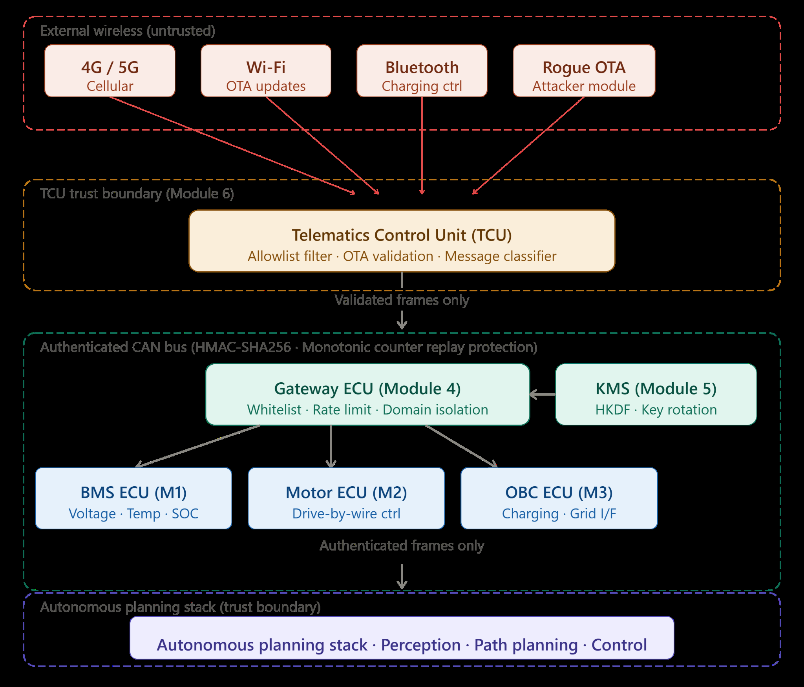

# SecureEV

**A multi-layer cybersecurity framework prototype for autonomous electric vehicles.**

SecureEV models security controls for communication between vehicle ECUs and for messages entering the vehicle through external wireless interfaces. The project is implemented as a Python simulation with a virtual CAN bus, authenticated CAN frames, a gateway enforcement point, key management, a telematics trust boundary, attack simulations, evaluation scripts, tests, and an animated dashboard.

> **Research prototype:** SecureEV is a simulation and evaluation project. It is not a production-ready automotive security implementation and must not be connected to a real vehicle or safety-critical system.

## Architecture

The architecture below is the project architecture diagram.



### High-level data flow

1. **External wireless inputs** — the diagram identifies cellular (4G/5G), Wi-Fi OTA updates, Bluetooth charging control, and a rogue OTA attacker as untrusted inputs.
2. **Telematics Control Unit (TCU)** — acts as the wireless trust boundary. The implementation classifies incoming messages, checks its allowed message types, validates OTA payloads, checks charger identifiers for charging messages, and forwards accepted messages towards the gateway.
3. **Authenticated CAN communication** — ECU frames contain a CAN identifier, monotonic counter, payload, and message authentication code (MAC).
4. **Gateway ECU** — applies the implemented per-frame checks: CAN-ID allowlist, replay-counter validation, MAC verification, rate limiting, and the gateway's domain-check method.
5. **Key Management System (KMS)** — derives per-CAN-ID session keys with HKDF-SHA256 and supports epoch-based key rotation.
6. **Vehicle ECUs** — the BMS, Motor, and OBC modules generate their respective simulated vehicle messages.
7. **Autonomous planning stack** — shown as the downstream trust boundary in the supplied architecture diagram.

The diagram is a conceptual system view. The executable Python project currently models the ECU, TCU, gateway, KMS, attacker, and virtual-bus components; it does not implement a real cellular/Wi-Fi/Bluetooth hardware stack or an autonomous perception and path-planning stack.

## Main components

| Path | Responsibility |
|---|---|
| `models/frames.py` | Data structures for CAN frames and related records |
| `bus/virtual_bus.py` | In-memory virtual CAN bus |
| `crypto/mac.py` | HMAC generation/verification and HKDF key derivation |
| `modules/bms_ecu.py` | Simulated Battery Management System ECU |
| `modules/motor_ecu.py` | Simulated motor / drive-by-wire ECU |
| `modules/obc_ecu.py` | Simulated On-Board Charger ECU and charger-ID validation |
| `modules/kms.py` | Per-ECU session-key derivation and key rotation |
| `modules/gateway_ecu.py` | CAN frame validation and rejection logging |
| `modules/tcu.py` | Wireless-message classification and validation boundary |
| `attacker/attacker.py` | Simulated CAN attack traffic |
| `evaluation/benchmark.py` | MAC and frame-pipeline latency benchmarks |
| `evaluation/generate_hybrid_dataset.py` | Generates the combined SecureEV/KAIST evaluation CSV |
| `evaluation/hybrid_eval.py` | Evaluates the generated hybrid dataset through the gateway |
| `evaluation/kaist_eval.py` | Evaluates KAIST dataset CSV files through the gateway |
| `tests/` | Unit and integration tests |
| `main.py` | Application entry point; starts the simulation thread and launches the Flask server |
| `dashboard3.py` | Flask application, dashboard routes, simulation loop, and dashboard interface |

## Security mechanisms represented

- **Message authentication:** HMAC-SHA256 is used to calculate a MAC over the CAN identifier, counter, and payload.
- **Key derivation:** HKDF with SHA-256 derives session keys for CAN identifiers.
- **Key rotation:** the KMS rotates keys using epochs.
- **Replay protection:** the gateway checks that a frame counter advances within its configured acceptance window.
- **CAN-ID allowlisting:** the gateway accepts only configured CAN identifiers.
- **Rate limiting:** per-CAN-ID frame rates are checked against configured limits.
- **TCU validation:** wireless message types are classified and checked against an allowlist; OTA and charging messages receive additional validation.
- **Attack simulation:** the attacker module creates malicious or invalid frames for testing the gateway controls.

### Implementation note

The current `crypto/mac.py` implementation truncates the 32-byte HMAC-SHA256 output to **2 bytes** (`full_mac[:2]`). This is the implementation's current behaviour, not a recommended production MAC length. Also, `GatewayECU._check_domain()` currently returns `True` for every frame, while `check_domain_cross()` is a separate helper and is not called by `receive()`. Therefore, the diagram's domain-isolation label should not be interpreted as proof that cross-domain traffic is currently blocked in the per-frame gateway pipeline. These are important security limitations to disclose and evaluate during review. The project should not be represented as production-grade cryptography or enforcement.

## Repository layout

```text
SecureEV/
├── attacker/
│   └── attacker.py
├── bus/
│   └── virtual_bus.py
├── crypto/
│   └── mac.py
├── dataset/
│   ├── hybrid/
│   └── kaist/              # Large source CSVs kept locally / outside Git
├── docs/
│   └── architecture.png
├── evaluation/
│   ├── benchmark.py
│   ├── generate_hybrid_dataset.py
│   ├── hybrid_eval.py
│   └── kaist_eval.py
├── logs/
├── models/
│   └── frames.py
├── modules/
│   ├── bms_ecu.py
│   ├── gateway_ecu.py
│   ├── kms.py
│   ├── motor_ecu.py
│   ├── obc_ecu.py
│   └── tcu.py
├── tests/
├── main.py                 # Application startup entry point
├── dashboard3.py           # Flask dashboard and simulation logic
├── requirements.txt
└── README.md
```

## Requirements

- Python 3.9 or later
- pip
- Flask
- `cryptography`
- `pytest` (for running the test suite)

## Setup

From the repository root:

```bash
python -m venv venv
```

Activate the environment.

**Linux / WSL:**

```bash
source venv/bin/activate
```

**Windows PowerShell:**

```powershell
.\venv\Scripts\Activate.ps1
```

Install dependencies:

```bash
python -m pip install --upgrade pip
pip install -r requirements.txt
```

## Run SecureEV

`main.py` is the primary application entry point. It imports the Flask application and simulation loop from `dashboard3.py`, starts the simulation in a background thread, and launches the Flask development server.

From the repository root, activate the virtual environment and run:

```bash
python main.py
```

The application starts the dashboard server on port **5002**. Open the following address in your browser:

```text
http://localhost:5002
```

### Application startup flow

1. `main.py` imports `app`, `sim_loop`, and `REAL` from `dashboard3.py`.
2. It reports whether the dashboard is using the real project modules or the mock-simulation fallback.
3. It starts `sim_loop()` in a daemon background thread.
4. It runs the Flask application with threaded request handling and debugging disabled.

`dashboard3.py` retains the dashboard routes, interface, and simulation implementation. It is not necessary to run `dashboard3.py` directly for the normal application workflow; use `python main.py`.

The dashboard attempts to import and run the project modules. If those imports are unavailable, its source contains a mock-simulation fallback.

## Run tests

From the repository root:

```bash
pytest -q
```

## Dataset generation and evaluation

The evaluation scripts expect the relevant CSV files at the paths configured inside those scripts.

Generate the hybrid dataset:

```bash
python evaluation/generate_hybrid_dataset.py
```

Evaluate the generated hybrid dataset:

```bash
python evaluation/hybrid_eval.py
```

Evaluate the KAIST CSV datasets:

```bash
python evaluation/kaist_eval.py
```

The KAIST evaluation script expects these files under `dataset/kaist/`:

- `DoS_dataset.csv`
- `Fuzzy_dataset.csv`
- `RPM_dataset.csv`
- `gear_dataset.csv`

These source datasets can be large. Keep them locally or distribute them through an appropriate dataset repository / Git LFS rather than committing oversized CSVs to ordinary Git history. The hybrid dataset generator also reads these KAIST files when they are available.

## Run the benchmark

```bash
python evaluation/benchmark.py
```

## Git and dataset note

Large research datasets should not be committed to ordinary Git if they exceed GitHub's 100 MB per-file limit. The four KAIST CSV files listed above are intentionally excluded from the repository in this project setup; obtain or place them locally before running the KAIST and hybrid dataset generation workflows.

## Scope and limitations

- This repository simulates ECU and gateway behaviour in Python; it is not connected to physical CAN hardware by default.
- The architecture diagram includes conceptual external wireless sources and an autonomous planning stack. Those are not equivalent to implemented hardware or a complete autonomous-driving software stack.
- The MAC truncation, simulated key material, and other prototype shortcuts must be reviewed before any real-world deployment.
- Evaluation results depend on the exact dataset files, configuration, and scripts used. Record those details when reporting results.


